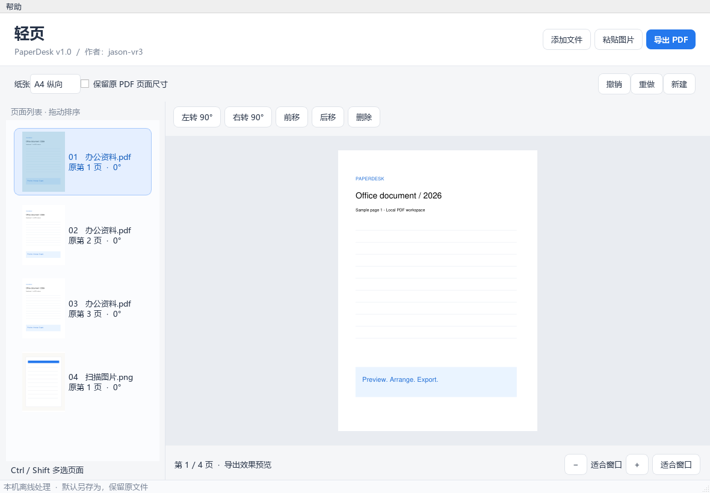

# 轻页 PaperDesk

**Windows 本机图片与 PDF 页面整理工具。** 中文界面，离线处理，无需账号，无遥测。

[](https://github.com/jason-vr3/PaperDesk/releases/tag/v1.0)
[](https://github.com/jason-vr3/PaperDesk/releases/latest)
[](LICENSE)

**作者：[jason-vr3](https://github.com/jason-vr3)** · **版本：v1.0** · [下载软件](https://github.com/jason-vr3/PaperDesk/releases/latest) · [反馈问题](https://github.com/jason-vr3/PaperDesk/issues)

本项目通过 **AI 辅助完成（OpenAI Codex）**，由作者确定需求并进行使用验证。详见 [AI 辅助开发说明](AI_ASSISTANCE.md)。



## 主要功能

| 功能 | 说明 |
| --- | --- |
| 图片转 PDF | 粘贴、拖入或选择多张图片，一图一页 |
| 页面预览 | 左侧缩略图、右侧导出效果预览，支持缩放 |
| 页面旋转 | 顺时针、逆时针旋转 90°，可多选 |
| 混合合并 | 图片与多个 PDF 放在同一页面列表中整理 |
| 插入与删除 | 指定 PDF 部分页加入、删除多余页、拖动排序 |
| A4 输出 | 默认 A4，支持横纵向和保留原 PDF 页面尺寸 |

常用流程：**添加文件／粘贴图片 → 排序、旋转、删除 → 导出 PDF**。

## 免安装使用

前往 [Releases 下载页](https://github.com/jason-vr3/PaperDesk/releases/latest)，下载 `PaperDesk-v1.0-Windows-x64.zip`，**先完整解压**，双击文件夹里的 `PaperDesk.exe`。无需安装 Python；请保留旁边的 `_internal` 文件夹。目标平台为 Windows 10/11 x64。

压缩包约 59 MB。`PaperDesk-v1.0-source.zip` 是源码包；GitHub 自动生成的 Source code 压缩包也属于源码，不能直接双击运行。`SHA256.json` 提供发行文件校验值。

1. 点击「添加文件」、拖入文件，或按 Ctrl+V 粘贴剪贴板图片。
2. 单独加入一个 PDF 时，可指定页码，例如 `1,3-5`，并选择插入位置。一次导入多个文件时按文件选择顺序添加全部页；可以在页面列表中调整顺序。
3. 左侧选中页面后，旋转、前移、后移或删除。Ctrl / Shift 可多选，支持拖动排序。添加图片默认插在当前页后面。
4. 选择 A4 纵向或横向，右侧预览与导出采用相同的排版方式。内容等比例居中，不拉伸、不裁切。
5. 点击「导出 PDF」，选择保存位置。默认另存为；如果选择原文件或其他已有文件，保存对话框会要求确认覆盖。

勾选「保留原 PDF 页面尺寸」后，PDF 页保持原尺寸；图片页仍使用所选 A4 方向。一张图片对应一页。原文件不会因页面整理操作而改变。

快捷键：Ctrl+O 添加，Ctrl+V 粘贴，Ctrl+S 导出，Ctrl+Z 撤销，Ctrl+Shift+Z 重做，Ctrl+L 左转，Ctrl+R 右转，Delete 删除，Alt+↑/↓ 移动，Ctrl+N 新建。

## 支持范围与边界

- 图片：PNG、JPEG、BMP、TIFF、WebP，自动处理 EXIF 方向和透明背景（白底）。多帧图片仅导入第一帧。
- PDF：预览、合并、选择部分页导入、插页、删页、排序、90°旋转。支持输入密码打开允许修改的文件。
- 保留普通 PDF 文字和矢量图形，不把整页转换成图片。不包含 OCR、编辑原有文字、Word/Excel 转 PDF、裁剪或压缩档位。
- 可见批注和表单外观会合入页面，导出后不可交互编辑。不保留书签、附件、交互链接及数字签名；请保留原始文件。
- 撤销/重做最近 50 次操作。关闭或新建会提示处理未导出内容。没有跨会话项目保存或崩溃恢复。
- 文档在内存中处理，不上传、不建立历史数据库。导出时在目标目录创建临时 PDF，成功后替换目标文件；异常中断可能遗留以 `.paperdesk-` 开头的临时文件。
- 主要面向普通办公文件。数百页或超大扫描件可能较慢，导入/导出期间界面会短暂等待；不是面向超大文档的专业编辑器。
- 首版尚未代码签名。作者已反馈本机使用测试可行；未在另一台无开发环境电脑上验证，跨系统兼容性仍待更多反馈，见 [验证记录](VALIDATION.md)。

## 源码运行

需要 Windows x64、Python 3.12。

```powershell
py -3.12 -m venv .venv
.\.venv\Scripts\python.exe -m pip install -r requirements.txt
.\.venv\Scripts\python.exe main.py
```

## 检查与打包

```powershell
.\.venv\Scripts\python.exe -m unittest discover -v
powershell -ExecutionPolicy Bypass -File build.ps1
```

输出：`dist/PaperDesk/` 是完整免安装文件夹；`release/` 包含免安装 ZIP、源码 ZIP 和 SHA256 校验值。打包采用目录形式，减少单文件每次启动的解压等待，并便于替换 Qt 动态库。

离线验证已打包程序（只生成示例资料）：

```powershell
$env:QT_QPA_PLATFORM = 'offscreen'
.\dist\PaperDesk\PaperDesk.exe --self-check .\tmp\packaged-check
Remove-Item Env:QT_QPA_PLATFORM
```

## 项目结构

- `paperdesk/core.py`：页面模型、图片标准化、PDF 合成、原子保存。
- `paperdesk/app.py`：桌面界面、粘贴、页面操作、撤销与导出。
- `tests/`：导出内容、旋转方向、错误保护和界面行为测试。
- `scripts/build.py`、`build.ps1`：构建、许可证收集、源码及免安装包。
- `CHANGELOG.md`、`AI_ASSISTANCE.md`：版本更新与 AI 辅助开发披露。

## 开源与 GitHub

本项目采用 **AGPL-3.0-or-later**，与所用 PyMuPDF 的开源授权相匹配。发布修改版时也需要按许可证提供对应源码；不要把它当作宽松的 MIT 许可项目。依赖与许可证见 `THIRD_PARTY_NOTICES.md` 以及发行包 `licenses/`。

Copyright © 2026 [jason-vr3](https://github.com/jason-vr3)。项目不对文档处理结果提供保证，完整条款见 [LICENSE](LICENSE)。

欢迎提交 Issue 和 Pull Request。参与方式见 [贡献指南](CONTRIBUTING.md)，社区规则见 [行为准则](CODE_OF_CONDUCT.md)，安全问题见 [安全反馈说明](SECURITY.md)。软件版本变化见 [更新记录](CHANGELOG.md)。

免安装文件通过 GitHub Releases 提供；源码仓库不包含虚拟环境、构建输出或私人文档。
